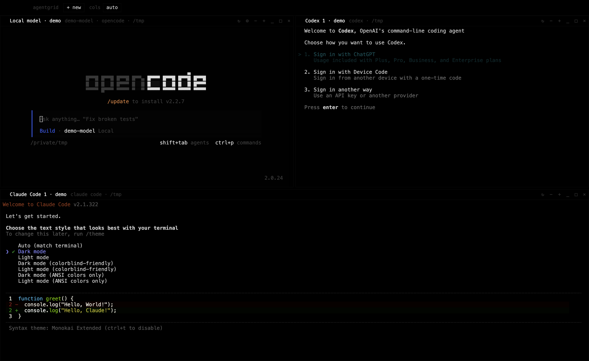

# AgentGrid

**Run many AI coding agents side by side — each with its own account.**
Claude Code, Codex, Kimi, DeepSeek, GLM, Qwen, Grok and local Ollama models in one minimal black-and-white tiling terminal for macOS. No logging out, no account switching, no extra VS Code windows.



## Why

- Claude Code and Codex support **one account per window**. If you have two Claude accounts and three ChatGPT accounts, you end up logging out and in, or juggling terminals.
- Third-party coding models (Kimi, DeepSeek, GLM, Qwen, local models) need environment variables and endpoint juggling every time.
- Chat sites such as claude.ai and chatgpt.com can't be embedded in VS Code with separate logins.

AgentGrid gives every window its **own isolated login** and lets you drag them into any layout.

## Features

- **Unlimited parallel accounts** — e.g. 3× Claude Code with 3 different accounts next to 2× Codex.
- **Real tools, not look-alikes** — each tile is the actual `claude`, `codex` or `opencode` CLI in a real pty (xterm.js), working in the project folder you choose.
- **Any provider as a coding agent** — Kimi, DeepSeek, GLM, Qwen and Ollama run through Claude Code against their Anthropic-compatible endpoints; Grok and any OpenAI-compatible endpoint run through [opencode](https://opencode.ai).
- **Chat websites as tiles too** — Claude, ChatGPT, Kimi, Qwen, DeepSeek, GLM, Gemini, Grok, Perplexity, Le Chat or any URL. Every site tile has its own persistent cookie jar, so the same site can be open with several accounts.
- **Drag-to-resize** tiles, auto grid or fixed column count, maximize/hide per tile, per-tile zoom.
- **Keys stay local** — API keys are encrypted with the macOS keychain (Electron `safeStorage`). No telemetry, no server.
- Minimal by design: black, white, monospace.

## Supported agents

| Tile | Runs | Account / auth |
|---|---|---|
| Claude Code | `claude` | Subscription login (separate config folder per tile) |
| Codex | `codex` | ChatGPT login (separate `CODEX_HOME` per tile) |
| Kimi (Moonshot) | Claude Code → `api.moonshot.ai/anthropic` | API key |
| DeepSeek | Claude Code → `api.deepseek.com/anthropic` | API key |
| GLM (Z.ai) | Claude Code → `api.z.ai/api/anthropic` | API key |
| Qwen (Alibaba Model Studio) | Claude Code → `dashscope-intl.aliyuncs.com/apps/anthropic` | API key |
| Ollama (local) | Claude Code → `localhost:11434` | none (Ollama ≥ 0.14) |
| Grok (xAI) | opencode → `api.x.ai/v1` | API key |
| Custom | Claude Code (Anthropic format) or opencode (OpenAI format) | API key |
| Websites | claude.ai, chatgpt.com, kimi.com, … | Own login per tile |

Default model ids are editable (⚙ in the tile header) because providers rename models often.

## Install

**Download** the latest `AgentGrid-macos-arm64.zip` from [Releases](https://github.com/Quinn08jjj/agentgrid/releases), unzip, move `AgentGrid.app` to Applications. The app is not notarized: right-click → *Open* the first time.

**From source** (also for Intel Macs):

```bash
git clone https://github.com/Quinn08jjj/agentgrid.git
cd agentgrid
npm install
npm start          # or: npm run build  → dist/AgentGrid-darwin-*/AgentGrid.app
```

Requirements: macOS, Node 20+ (source builds). Claude Code must be installed for Claude tiles; Codex and opencode are installed on demand into `~/.agentgrid/tools` (no global installs).

## Usage

1. Click **+ new** and pick an agent.
2. For Claude Code / Codex choose *New separate login* (own folder → own account) or *Existing login*, then pick the project folder.
3. For API providers enter model and key, then pick the project folder.
4. Drag the lines between tiles to resize. Double-click a tile name to rename it.

### Open it from VS Code

`vscode/` contains a tiny launcher extension: `Cmd+Shift+D` opens AgentGrid. Install with
`cd vscode && npx @vscode/vsce package && code --install-extension agentgrid-launcher-*.vsix`.

## How it works

- Claude Code tiles set `CLAUDE_CONFIG_DIR` per tile, Codex tiles set `CODEX_HOME` per tile — each folder holds its own credentials, history and settings.
- API-provider tiles export `ANTHROPIC_BASE_URL`, `ANTHROPIC_AUTH_TOKEN` and the model variables for that tile only.
- Website tiles are Electron `WebContentsView`s with a dedicated `persist:` session partition each.
- Terminals are `node-pty` + xterm.js. Everything is stored under `~/Library/Application Support/AgentGrid` and `~/.agentgrid`.

## Limitations

- Built and tested on macOS (Apple Silicon). Windows/Linux are not supported yet.
- Pointing Claude Code at non-Anthropic models is a community technique; features like extended thinking or some tools may behave differently. Provider endpoints and model ids were taken from their public docs and may change.
- "Sign in with Google" is often blocked inside embedded browsers; use email login in website tiles.
- Please check each provider's terms before running several accounts in parallel. AgentGrid is an unofficial tool and is not affiliated with Anthropic, OpenAI, Moonshot, DeepSeek, Zhipu, Alibaba or xAI.

## Alternatives

Looking for something different? These projects solve related problems: [mcode](https://github.com/roman10/mcode) (tiling IDE for agent sessions), [clauth](https://docs.rs/crate/clauth) (terminal account switcher), [claude-swap](https://github.com/realiti4/claude-swap), [claude-multiprofile](https://github.com/jmdarre-v/claude-multiprofile). AgentGrid's focus is *many accounts and providers visible at once*, minimal UI, and mixing CLI agents with chat websites.

## FAQ

**How do I use two Claude Code accounts at the same time?**
Add two *Claude Code* tiles and choose *New separate login* for each; log in once inside each tile.

**How do I run multiple Codex / ChatGPT accounts in parallel?**
Same: one *Codex* tile per account, each with its own `CODEX_HOME`.

**Can I use Kimi, DeepSeek, GLM or Qwen as a Claude Code–style coding agent?**
Yes — add them under *Coding agent via API key*. Claude Code is launched against the provider's Anthropic-compatible endpoint with your key.

**Can I use a local model?**
Yes: choose *Local model (Ollama)*, run Ollama with a tool-capable coding model pulled.

**Does it send my keys or code anywhere?**
No server, no telemetry. Keys are encrypted by the OS keychain; traffic goes straight from the tool to the provider you configured.

## License

[MIT](LICENSE)
